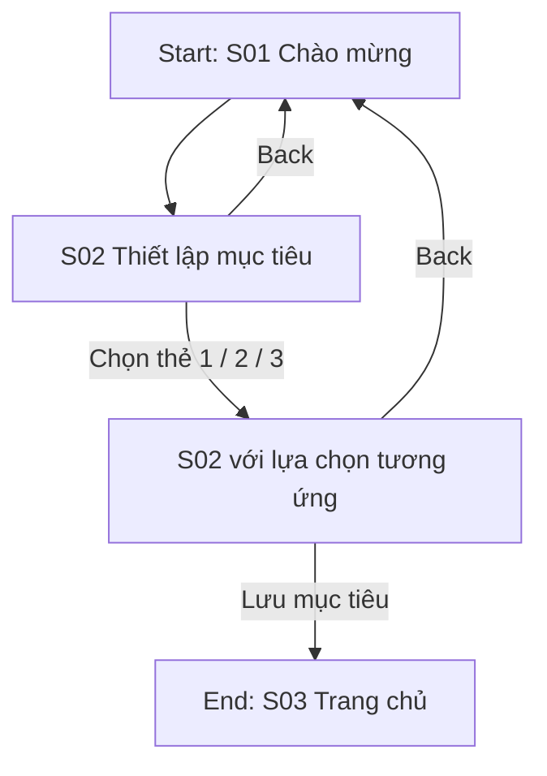
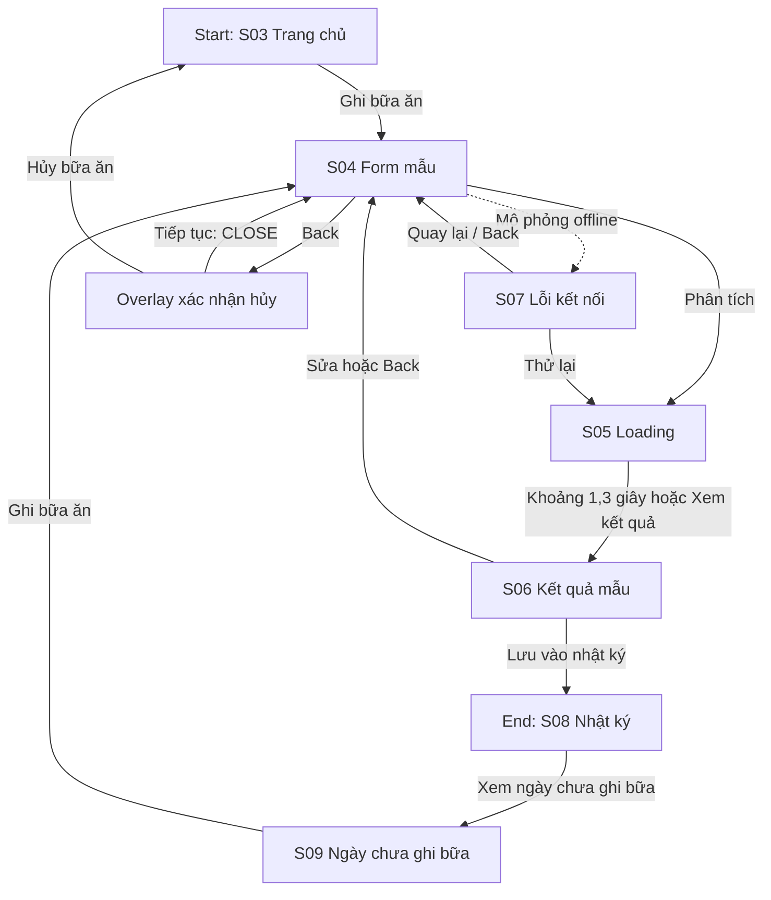
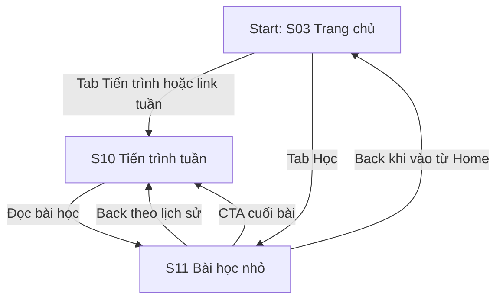

# User flows — Nếp Lành

## Cơ sở và phạm vi

File thiết kế: [Nếp Lành — Figma](https://www.figma.com/design/Cc2O3xSmxgjfvDI2hrsY3Q). Đã cập nhật liên kết và trạng thái lựa chọn qua Figma MCP ngày 22/10/2026. [Review lượt sửa](../docs/reviews/current-fix-review.md) ghi bằng chứng kiểm tra mới và kết quả Present/quyền xem; [audit JSON](../design/figma-audit.json) ghi cấu trúc. Không dùng audit tĩnh để suy ra toàn bộ thao tác đã chạy trong Present.

QA sau sửa đã đạt ba flow, ba lựa chọn mục tiêu, 15 tab chưa chọn, retry, overlay, empty và Back theo ngữ cảnh. Present truy cập được khi không đăng nhập; editor chưa xác minh do CloudFront 403. Xem review để đối chiếu bằng chứng và đường dẫn Present.

Các flow là mô phỏng giao diện, không chứng minh backend, lưu bền vững, đồng bộ, xử lý mạng hoặc phân tích dinh dưỡng thật. Nếp Lành mang tính giáo dục, không chẩn đoán, điều trị hoặc cam kết phòng bệnh. Dialog hủy là overlay, không phải màn hình chức năng bổ sung.

## Danh sách màn hình và đối chiếu node

Node Final UI thuộc trang 03; node Prototype thuộc trang 06. Các bản chọn mục tiêu là biến thể của S02, không được tính thêm màn hình.

| ID | Tên màn hình | Final UI node | Prototype node | Vai trò |
| --- | --- | --- | --- | --- |
| S01 | Chào mừng | `6:2` | `13:418` | Điểm vào onboarding |
| S02 | Thiết lập mục tiêu | `6:19` | `13:434` | Chọn mục tiêu 1; chọn mục tiêu 2/3 dùng `63:267` / `63:291` |
| S03 | Trang chủ | `6:42` | `13:447` | Điểm vào ghi bữa và điều hướng cấp cao |
| S04 | Ghi bữa ăn | `6:76` | `13:465` | Form mẫu Filled, loading và nhánh mô phỏng offline |
| S05 | Đang phân tích | `6:101` | `13:476` | Loading, tự chuyển sau khoảng 1,3 giây; có “Xem kết quả” dự phòng |
| S06 | Kết quả | `6:118` | `13:485` | Kết quả mẫu và CTA tới nhật ký |
| S07 | Lỗi kết nối | `6:138` | `13:497` | Retry hoặc quay lại kiểm tra biểu mẫu |
| S08 | Nhật ký bữa ăn | `6:155` | `13:507` | Có bản ghi mẫu; có link xem ngày chưa ghi bữa |
| S09 | Ngày chưa ghi bữa | `6:186` | `13:522` | Empty state theo ngày; mở từ S08 và có CTA ghi bữa |
| S10 | Tiến trình tuần | `6:213` | `13:534` | Tiến trình mẫu và đường đọc bài học |
| S11 | Bài học nhỏ | `6:257` | `13:563` | Back theo nguồn vào; CTA cuối bài tới S10 |

**Overlay:** Xác nhận hủy bữa ăn — Final UI `10:126`, Prototype `13:579`.

## Điểm bắt đầu và điều hướng cấp cao

Trang 06 có ba native flow starting points trên launch cards: `13:373` (Flow 1), `13:378` (Flow 2), `13:383` (Flow 3). Từ launch card tương ứng, đi tới S01 hoặc S03 rồi chạy đường chính dưới đây.

Trên Home, Journal, Empty, Weekly và Article, mọi tab chưa chọn đều nối tới destination Trang chủ S03 / Nhật ký S08 / Tiến trình S10 / Học S11. Tab đang chọn có dấu ✓ và không chuyển trang khi bấm. Empty vẫn chọn tab Nhật ký. Link “Xem tiến trình tuần” trên Home (`13:458`) cũng mở S10; không cần đi vòng qua tab.

```text
Flow 1: S01 → S02 [chọn 1 / 2 / 3] → S03
Flow 2: S03 → S04 → S05 --(~1,3 giây / Xem kết quả)→ S06 → S08
                   ├─ Mô phỏng offline → S07 → Thử lại → S05 → S06
                   └─ Back → overlay → CLOSE về S04 / Hủy bữa ăn → S03
        S08 --Xem ngày chưa ghi bữa→ S09 → S04
Flow 3: S03 → S10 → S11 --Back→ S10
        S03 --tab Học→ S11 --Back→ S03
        S11 --CTA cuối bài→ S10
```

## Flow 1 — Chào mừng và chọn mục tiêu

**Bắt đầu:** launch Flow 1 → S01. **Mục tiêu:** chọn một mục tiêu và tới Trang chủ. **Kết thúc:** S03.



- **Đường chính:** S01 → S02 → chọn thẻ → Lưu mục tiêu → S03.
- **Nhánh thay thế:** đổi thẻ để chuyển giữa ba biến thể lựa chọn; Back trở lại S01.
- **Phản hồi:** thẻ đã chọn có dấu ✓ và nhãn “Đã chọn”, không chỉ thay màu nền.
- **Giới hạn:** thao tác chọn là chuyển giữa các frame trạng thái mẫu. Save mở Home với dữ liệu mẫu, không chứng minh mục tiêu được lưu hoặc phản ánh động trên Home. Nhắc nhở và bỏ qua chưa được thiết kế trong flow này.
- **Ánh xạ:** S01, S02 và hai bản trạng thái S02, S03.

## Flow 2 — Ghi bữa, phục hồi lỗi và xem nhật ký

**Bắt đầu:** launch Flow 2 → S03. **Mục tiêu:** mở form, xem kết quả mẫu và tới nhật ký; có thể phục hồi từ lỗi mô phỏng. **Kết thúc:** S08 hoặc S03 khi xác nhận hủy.



- **Đường chính:** S03 → S04 → S05 → S06 → S08. S05 dùng timer khoảng 1,3 giây; nút “Xem kết quả” (`67:403`) là đường dự phòng tới S06. Không có nhánh timer S05 → S07.
- **Nhánh sửa/thêm:** S06 Back/Edit → S04; S08 Ghi thêm → S04. S03 tab Nhật ký có thể mở S08 trực tiếp.
- **Lỗi/phục hồi:** link mô phỏng offline từ S04 mở S07. Retry → S05 → S06; Back hoặc hành động quay lại → S04. Nội dung lỗi hướng dẫn “Quay lại biểu mẫu để kiểm tra thông tin bữa ăn.”, không hứa đã lưu dữ liệu trên thiết bị.
- **Hủy:** Back ở S04 mở overlay. “Tiếp tục chỉnh sửa” đóng overlay, giữ frame S04 bên dưới; “Hủy bữa ăn” mở S03.
- **Trạng thái rỗng:** link “Xem ngày chưa ghi bữa” (`63:365`) trên S08 mở S09; CTA S09 mở S04. Đây là ngày không có bản ghi trong dữ liệu mẫu, không ngụ ý toàn bộ nhật ký chưa từng có dữ liệu.
- **Giới hạn:** fields là giá trị mẫu Filled; không có nhập liệu, persistence, ghi offline hoặc validation ứng dụng thật.
- **Ánh xạ:** S03–S09 và overlay; S05/S07/S09 là trạng thái, không tính thành màn chức năng riêng.

## Flow 3 — Tiến trình tuần và bài học

**Bắt đầu:** launch Flow 3 → S03. **Mục tiêu:** mở tiến trình, đọc bài và quay lại. **Kết thúc chính:** S10.



- **Đường chính:** S03 → S10 → S11 → Back hoặc CTA → S10.
- **Nhánh thay thế:** tab Học trên S03 mở thẳng S11; AppBar dùng hành động `BACK` để về S03 theo nguồn vào. CTA cuối bài vẫn đi S10 ở cả hai đường vào.
- **Phản hồi ngoài màu:** chart có text “Đã ghi: T2–T6 · Chưa ghi: T7, CN”; selected navigation có dấu ✓.
- **Giới hạn:** dữ liệu tuần/bài đọc là dữ liệu mẫu; chưa có cache, tải bài thật hoặc trạng thái đã đọc được lưu.
- **Ánh xạ:** S03, S10, S11.

## Bảng ánh xạ flow–màn hình

| Flow | Đường chính | Nhánh thay thế/phục hồi |
| --- | --- | --- |
| 1. Chọn mục tiêu | S01 → S02 → S03 | Ba trạng thái chọn thẻ; Back S02 → S01 |
| 2. Ghi bữa ăn | S03 → S04 → S05 → S06 → S08 | Offline/retry; sửa; overlay hủy; S08 → S09 → S04 |
| 3. Tiến trình và bài học | S03 → S10 → S11 → S10 | Home → Học → Back về Home; CTA cuối bài về Weekly |

## Hành vi sản phẩm cần triển khai sau prototype

- Lưu lựa chọn mục tiêu thật và cập nhật Home; xác định riêng nhu cầu bỏ qua, đổi mục tiêu và nhắc nhở.
- Validation form, lưu draft/local commit, xử lý lỗi mạng, chống bản ghi trùng và đồng bộ. Không báo thành công trước khi lưu thật.
- Thay timer loading bằng trạng thái service; giữ đường thoát/phục hồi nếu dịch vụ chậm hoặc lỗi.
- Chọn ngày và empty state theo dữ liệu thực thay cho link demo.
- Kiểm thử trên thiết bị với bàn phím, text scaling và trình đọc màn hình; kết quả Figma không thay thế kiểm thử ứng dụng.
