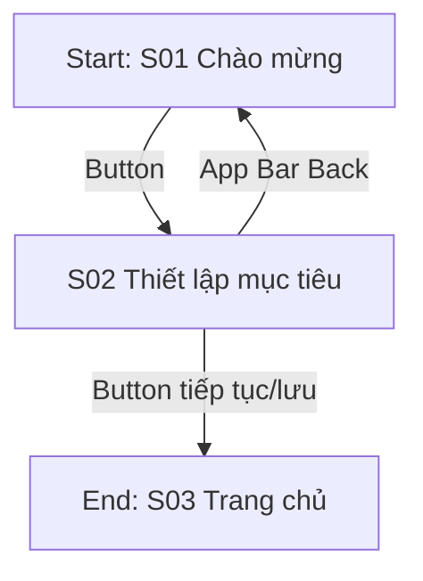
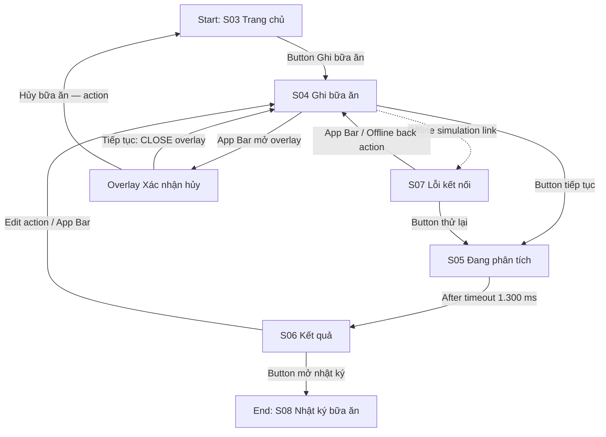
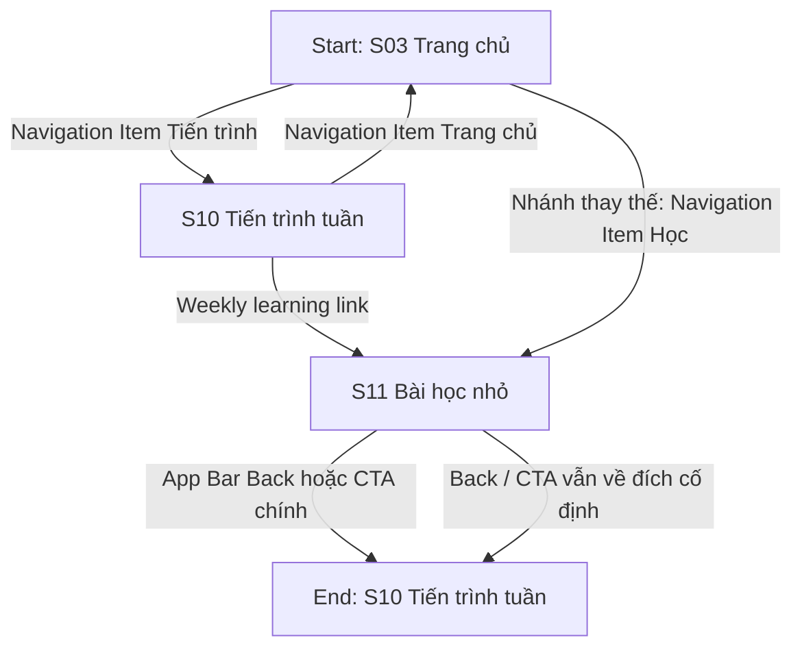

# User flows — Nếp Lành

## Cơ sở và phạm vi

Đối chiếu prototype hiện tại trong Figma `Cc2O3xSmxgjfvDI2hrsY3Q` với [bản audit phản ứng](../design/figma-audit.json). Audit là kết quả đọc cấu trúc tương tác tĩnh, chưa phải walkthrough trực tiếp trong Present. Bảng dưới đây tách node của trang `03 Final UI` khỏi node của trang `06 Prototype` để tránh nhầm ID.

Các flow mô tả đúng những liên kết prototype đã ghi nhận. Chúng không hàm ý đã có backend, lưu dữ liệu bền vững, đồng bộ, phân tích dinh dưỡng thật hoặc xử lý mạng thật. Mục `Hành vi dự kiến cho sản phẩm` ở cuối ghi riêng các việc cần thiết kế/triển khai sau này.

Nếp Lành hỗ trợ người dùng tự ghi bữa ăn, đặt mục tiêu linh hoạt và đọc nội dung dinh dưỡng phổ thông. Ứng dụng không chẩn đoán, điều trị, dự đoán nguy cơ hoặc cam kết phòng bệnh. Dialog xác nhận hủy là overlay, không phải màn hình thứ 12.

## Danh sách màn hình và đối chiếu node

| ID | Tên màn hình | Final UI node | Prototype node | Vai trò |
|---|---|---:|---:|---|
| S01 | Chào mừng | `6:2` | `13:418` | Điểm vào flow bắt đầu |
| S02 | Thiết lập mục tiêu | `6:19` | `13:434` | Trang lựa chọn mục tiêu; các thẻ mục tiêu hiện chưa có reaction riêng |
| S03 | Trang chủ | `6:42` | `13:447` | Điểm vào Ghi bữa ăn và các tab điều hướng |
| S04 | Ghi bữa ăn | `6:76` | `13:465` | Nhập bữa ăn, bắt đầu loading hoặc mở mô phỏng offline |
| S05 | Đang phân tích | `6:101` | `13:476` | Loading; tự chuyển đến Kết quả sau 1.300 ms |
| S06 | Kết quả | `6:118` | `13:485` | Kết quả trình diễn và đường mở/sửa nhật ký |
| S07 | Lỗi kết nối | `6:138` | `13:497` | Trạng thái mô phỏng offline với thử lại/quay về nhập liệu |
| S08 | Nhật ký bữa ăn | `6:155` | `13:507` | Nhật ký có bản ghi; có đường thêm bữa ăn và về Trang chủ |
| S09 | Nhật ký trống | `6:186` | `13:522` | Empty state; có CTA sang Ghi bữa ăn nhưng chưa có đường vào từ flow khởi chạy chính |
| S10 | Tiến trình tuần | `6:213` | `13:534` | Xem tiến trình và mở liên kết bài học |
| S11 | Bài học nhỏ | `6:257` | `13:563` | Bài học; cả Back và CTA chính đều về S10 |

**Overlay (không tính là màn hình):** `Xác nhận hủy bữa ăn` — Final UI node `10:126`, Prototype node `13:579`.

## Điều hướng đã nối trong prototype

Các khu vực cấp cao là Trang chủ (S03), Nhật ký (S08/S09), Tiến trình (S10) và Học (S11 qua tab). S01/S02 thuộc onboarding; S04 là màn nhập lồng, S05/S07 là trạng thái xử lý/lỗi, S06 là kết quả. S11 còn được mở từ S10; overlay hủy thuộc S04. Cấu trúc này là IA; mức wiring hiện có được ghi bên dưới.

Từ S03, các reaction được audit dẫn tới S04 Ghi bữa ăn, S08 Nhật ký bữa ăn, S10 Tiến trình tuần và S11 Bài học nhỏ. Tab Nhật ký trên Trang chủ hiện dẫn tới S08; không có reaction từ S03 tới S09. S09 vẫn là frame có CTA sang S04 và tab điều hướng về S03, nhưng phải được mở thủ công để trình bày empty state.

```text
Flow 1: S01 → S02 → S03
Flow 2: S03 → S04 → S05 --(sau 1.300 ms)→ S06 → S08
                   ├─ Offline simulation link → S07 → thử lại → S05 → S06
                   └─ App Bar → overlay xác nhận hủy → CLOSE về S04 / xác nhận hủy → S03
Flow 3: S03 → S10 → S11 → S10
                    S03 → S11 (tab Học) → S10
S09 (mở thủ công) → S04; tab của S09 → S03
```

## Flow 1 — Chào mừng và thiết lập mục tiêu

**Bắt đầu:** người dùng ở S01 Chào mừng.<br>
**Mục tiêu:** đi qua màn hình thiết lập mục tiêu và tới Trang chủ.<br>
**Kết thúc:** S03 Trang chủ.



- **Đường chính:** S01 —Button→ S02 —Button→ S03.
- **Nhánh thay thế:** App Bar ở S02 quay về S01; người dùng có thể tiếp tục lại từ đó.
- **Giới hạn prototype:** mục tiêu được trình bày bằng các thẻ tĩnh; audit không thấy reaction chọn riêng trên thẻ. Vì vậy, flow hiện chỉ chứng minh đường tiếp tục và Back, không chứng minh việc chọn mục tiêu đã được lưu.
- **Ánh xạ màn hình:** S01, S02, S03.

## Flow 2 — Ghi bữa ăn, xử lý mô phỏng lỗi kết nối và xem nhật ký

**Bắt đầu:** người dùng ở S03 Trang chủ.<br>
**Mục tiêu:** mở form ghi bữa ăn, xem trạng thái/kết quả prototype và tới nhật ký.<br>
**Kết thúc:** S08 Nhật ký bữa ăn; nhánh lỗi có thể thử lại hoặc hủy thao tác.



- **Đường chính:** S03 → S04 → S05 → S06 → S08. S05 tự đi tiếp tới S06 sau 1.300 ms; reaction đó không dẫn tới S07.
- **Nhánh thay thế:** S06 có reaction quay lại S04 để sửa; S03 có tab Nhật ký dẫn trực tiếp tới S08. S08 có nút quay lại S04 để ghi thêm bữa.
- **Lỗi/phục hồi:** lỗi được mở từ Offline simulation link trên S04. Từ S07, nút thử lại đưa tới S05 rồi timer 1.300 ms đưa tới S06; App Bar và Offline back action đưa về S04. Đây là mô phỏng trong prototype, không xác nhận xử lý mạng hoặc lưu offline thật.
- **Hủy:** App Bar trên S04 mở overlay `10:126` / `13:579`. Nút tiếp tục đóng overlay (`CLOSE`) và để S04 bên dưới; nút xác nhận hủy điều hướng về S03.
- **Trạng thái rỗng:** S09 không có route vào từ Trang chủ trong flow hiện tại. Khi frame được mở thủ công, CTA của S09 dẫn tới S04 và tab điều hướng dẫn tới S03. Không thể trình bày đây là nhánh đã nối từ S03.
- **Ánh xạ màn hình:** đường chính S03, S04, S05, S06, S08; lỗi S07; S09 là frame trạng thái rỗng rời, không thuộc đường đi nối từ launch chính. Overlay hủy không tính là màn hình.

## Flow 3 — Xem tiến trình tuần và mở bài học

**Bắt đầu:** người dùng ở S03 Trang chủ.<br>
**Mục tiêu:** mở Tiến trình tuần, đọc Bài học nhỏ và quay lại Tiến trình tuần.<br>
**Kết thúc chính:** S10 Tiến trình tuần.



- **Đường chính:** S03 → S10 → S11 → S10.
- **Nhánh thay thế:** tab Học trên S03 mở thẳng S11; tại S11, cả App Bar Back và CTA chính đều về S10, không quay lại theo nguồn gọi.
- **Lỗi/phục hồi:** audit không ghi nhận lỗi tải bài học trong các reaction của những frame này; không khẳng định có cache hoặc đọc ngoại tuyến.
- **Ánh xạ màn hình:** S03, S10, S11.

## Bảng ánh xạ flow–màn hình

| Flow | Đường chính | Nhánh đã audit |
|---|---|---|
| 1. Thiết lập mục tiêu | S01 → S02 → S03 | Back S02 → S01; thẻ chọn mục tiêu chưa có reaction |
| 2. Ghi bữa ăn | S03 → S04 → S05 → S06 → S08 | Offline S04 → S07 → S05; sửa/quay lại S04; overlay xác nhận hủy; S09 detached, mở thủ công → S04 |
| 3. Tiến trình và bài học | S03 → S10 → S11 → S10 | S03 → S11 trực tiếp; cả hai control ở S11 vẫn → S10 |

## Hành vi dự kiến cho sản phẩm, chưa được prototype chứng minh

- Làm cho lựa chọn mục tiêu ở S02 tương tác được và định nghĩa rõ trạng thái mặc định, lưu, Back và bỏ qua.
- Nếu cần xử lý ghi bữa ăn khi mất mạng, xác định riêng quy tắc lưu cục bộ, retry, thông báo trạng thái và chống tạo bản ghi trùng; link mô phỏng hiện tại không chứng minh các hành vi này.
- Nếu S05 đại diện phân tích thật trong sản phẩm, xác định nguồn dữ liệu, nội dung giải thích và giới hạn; timer 1.300 ms hiện tại chỉ là chuyển cảnh prototype.
- Quyết định cách mở S09 trong prototype hoặc giữ rõ đây là frame trình bày trạng thái rỗng độc lập.
- Giữ nội dung dinh dưỡng ở mức giáo dục phổ thông, có nguồn và không đưa ra tuyên bố chẩn đoán, điều trị, phòng hoặc chữa bệnh.
